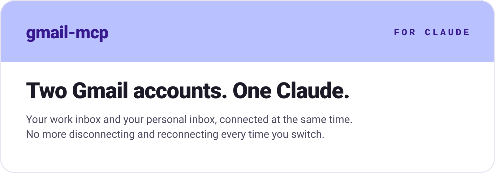
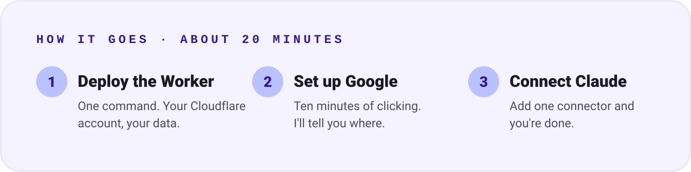

<p align="center">
  
</p>

# Gmail for Claude, times two

Claude's built-in Gmail connector holds one Google account. That drove me nuts. I have a work inbox and a personal inbox like most people. Every time I wanted Claude to look at the other one I had to go into settings, disconnect Google and connect it again. An hour later I'd do it all again in reverse.

I got tired of that and fixed it.

This is a small server you run on your own Cloudflare account. You add it to Claude as a custom connector for your second inbox and leave the built-in connector on your first. Now both stay connected. Ask Claude to "check my work inbox", "draft a reply from personal", or "search both for the invoice" and it does.

It works anywhere your Claude connectors do. That's claude.ai in the browser, the desktop app, your phone and Claude Code.

## Why you'd want this instead of something else

You've got options and some of them are fine. Zapier and similar services route your mail through their servers and bill you per call. Local MCP servers work great at your desk and disappear the moment you pick up your phone.

This one is yours. It runs in your Cloudflare account. Your Google tokens live there, encrypted. Nobody else's server sits between you and your mail, including mine. I never see any of it.

## How it goes

<p align="center">
  
</p>

You need a Cloudflare account (the free one works), [bun](https://bun.sh), git and about 20 minutes. Most of those minutes are spent clicking through Google Cloud, which has a few screens that will block you until they're filled in a specific way. I ran into every one of them so the [setup guide](./docs/SETUP.md) walks you around each.

The short version:

```sh
git clone https://github.com/KyleConway/gmail-mcp && cd gmail-mcp
bun install
./node_modules/.bin/wrangler login
bun run deploy          # prints https://gmail-mcp.<your-subdomain>.workers.dev
```

1. **Set up Google.** Create an External OAuth app, fill in its Branding page, publish it and make a **Web application** client with the redirect URI `https://<your-worker-host>/callback`.
2. **Hand the Worker its secrets.** Type the client secret yourself. Don't paste it into a chat with any AI, mine included.
   ```sh
   ./node_modules/.bin/wrangler secret put GOOGLE_CLIENT_ID
   ./node_modules/.bin/wrangler secret put GOOGLE_CLIENT_SECRET
   openssl rand -hex 32 | ./node_modules/.bin/wrangler secret put COOKIE_ENCRYPTION_KEY
   ./node_modules/.bin/wrangler secret put ALLOWED_EMAILS     # the Gmail address you're connecting
   ```
3. **Connect Claude.** In claude.ai, go to **Settings → Connectors → Add custom connector**, call it something like "Gmail – Personal" and use `https://<your-worker-host>/mcp/personal`. Leave the OAuth fields empty and hit **Connect**.
4. **Approve and sign in.** Approve the Worker's dialog and pick your Google account. Google will warn you the app isn't verified. That's expected because it's your app and you're its only user. Click **Advanced → Go to …**.
5. **Say hi.** Ask Claude to run `whoami`. It should tell you your address.

## Teaching Claude which inbox is which

Once both inboxes are connected, Claude needs to know which one is "work" and which one is "personal". Paste something like this into your personal preferences in Claude's settings (or into `~/.claude/CLAUDE.md` for Claude Code), with your own addresses:

```text
I have two Google accounts connected to Claude:
- Work: work@company.example. The built-in Gmail, Google Calendar and Google Drive connectors.
- Personal: me@gmail.example. The custom connector "Gmail – Personal" (Gmail only).

Rules:
- Use the account I name. For "both" or "all my email", search both and label each result with its account.
- If it isn't clear which account I mean, ask. Never send, reply or draft from an account I didn't name.
- An empty result means that one mailbox had nothing. Say which mailbox it was.
```

Don't skip the last rule. Without it Claude can search the wrong inbox, find nothing and tell you the email doesn't exist.

Got a third account? Add another connector with a different label, like `/mcp/family`, put that address in `ALLOWED_EMAILS` and bump `MAX_ACCOUNTS` in `wrangler.jsonc`.

## What Claude gets to do on its own

Every tool tells Claude whether it reads, writes or sends so you can let the harmless stuff run and make the rest ask first. In claude.ai, open the connector under **Settings → Connectors** and set:

| Setting | Tools |
| :-- | :-- |
| **Always allow** | `whoami`, `search_messages`, `get_message`, `get_thread`, `get_attachment`, `list_labels`, `list_drafts`, `create_draft`, `stage_attachment_begin`, `stage_attachment_append`, `stage_attachment_finish` |
| **Needs approval** | `update_draft`, `send_message`, `reply_all`, `forward_message`, `send_draft`, `delete_draft`, `trash_message`, `trash_thread`, `untrash_message`, `untrash_thread`, `modify_labels`, `modify_thread_labels`, `batch_modify_messages`, `create_label`, `update_label`, `delete_label` |

I let reading and drafting run on their own and make sending ask. A draft never leaves your mailbox until you send it. And if you never forward mail with Claude, block `forward_message` outright, because forwarding is the easiest way for an email with hidden instructions to get your mail sent somewhere else.

When Claude does send, `reply_all` and `send_draft` have to list every recipient so the approval prompt shows you who's getting the mail, including any Reply-To or Bcc.

## What it can do

27 tools covering the whole mailbox:

- **Read:** `whoami`, `search_messages`, `get_message`, `get_thread`, `get_attachment`
- **Write:** `send_message`, `reply_all`, `forward_message`, `create_draft`, `update_draft`, `send_draft`, `delete_draft`, `list_drafts`, `stage_attachment_begin`, `stage_attachment_append`, `stage_attachment_finish`
- **Organize:** `list_labels`, `create_label`, `update_label`, `delete_label`, `modify_labels`, `modify_thread_labels`, `batch_modify_messages`, `trash_message`, `untrash_message`, `trash_thread`, `untrash_thread`

Outgoing mail looks like it came from a regular mail client, with plain text, an HTML version, attachments and inline images. Emoji and non-Latin names come through intact. Long threads come back trimmed so they don't eat Claude's whole context.

It can't permanently delete anything. Trash is as far as it goes and Gmail keeps trash for 30 days.

## Stuff you should know

- **The free Cloudflare plan has a daily write cap.** Someone who finds your Worker's URL could burn through it and knock your connector offline until midnight UTC. They can't read anything. It's an annoyance. Workers Paid ($5/month) removes the cap.
- **It only talks to Claude, out of the box.** `claude mcp add`, the MCP Inspector and anything signing in through localhost get turned away. Claude Code still works, because it picks up your claude.ai connectors. If you really want another client, list its exact callback in `ALLOWED_REDIRECT_URIS` and keep in mind that each one you add is another way in.
- **First connection wins.** The first Claude connection to sign in to an account is the only one that ever can. So connect your own right after you deploy and never approve a sign-in you didn't start from Claude's **Connect** button. If you remove and re-add the connector later, the error page tells you how to reset it.
- **Google calls it unverified.** That's fine for your own personal app. Google allows unverified apps up to 100 users and you need one.

## Pulling the plug

Want to cut it off? Remove the app at [myaccount.google.com/connections](https://myaccount.google.com/connections), or delete the OAuth client in Google Cloud. Either one kills the tokens on the spot.

Don't count on rotating the client secret. Old tokens keep working after a rotation.

## Configuration

| Name | Kind | What it does |
| :-- | :-- | :-- |
| `GOOGLE_CLIENT_ID`, `GOOGLE_CLIENT_SECRET` | secret | Your Google OAuth Web application client |
| `COOKIE_ENCRYPTION_KEY` | secret | `openssl rand -hex 32`. Signs approval forms, cookies and attachment links |
| `ALLOWED_EMAILS` | secret | Who may sign in: addresses, `*@domain`, or `*`. Empty means nobody |
| `ALLOWED_CLIENT_IDS` | secret, optional | Exact OAuth client ids allowed to sign in. Overrides the automatic first-connection lock |
| `MAX_ACCOUNTS` | var | How many Google accounts may ever sign in. Default `1` |
| `PIN_FIRST_CLIENT` | var | Lock each account to its first connection. Default `"true"` |
| `ALLOWED_REDIRECT_URIS` | var, optional | Exact callback URIs that replace Claude's two. Unset means Claude only |

If you used `bun run setup` to put it on your own domain, it writes a `wrangler.local.jsonc` that wrangler reads instead of `wrangler.jsonc`. `bun run deploy` and `bun run dev` rebuild that file first so stick to those rather than calling `wrangler deploy` directly.

## Hacking on it

```sh
bun run check   # biome and type checks
bun test        # 418 tests
./node_modules/.bin/wrangler deploy --dry-run --outdir /tmp/gm-dry
python3 scripts/check-counts.py
```

[CLAUDE.md](./CLAUDE.md) covers how it's put together, the safety rules that must never regress and how to pull in changes from upstream.

## Credit

This started as a fork of [mkpoli/gmail-mcp](https://github.com/mkpoli/gmail-mcp) and mkpoli did the hard part. That includes the MCP server, all 27 Gmail tools, the MIME and charset handling and the OAuth plumbing. Give it a star.

I narrowed it to one job, being the second Gmail connector for Claude and tightened it up for that. I had the whole thing reviewed before I trusted it with my own mail, fixed everything the review turned up and wrote a test for each fix. [CHANGELOG.md](./CHANGELOG.md) has the full list. If you find something I missed, please tell me privately first. [SECURITY.md](./SECURITY.md) explains how.

## License

MIT. Copyright © 2026 mkpoli and Copyright © 2026 Kyle Conway for the changes in this fork. See [LICENSE](./LICENSE).

`src/workers-oauth-utils.ts` comes from Cloudflare's [remote-mcp-github-oauth demo](https://github.com/cloudflare/ai/tree/main/demos/remote-mcp-github-oauth), Copyright © 2025 Cloudflare, Inc., under the MIT License. See [THIRD-PARTY.md](./THIRD-PARTY.md).
