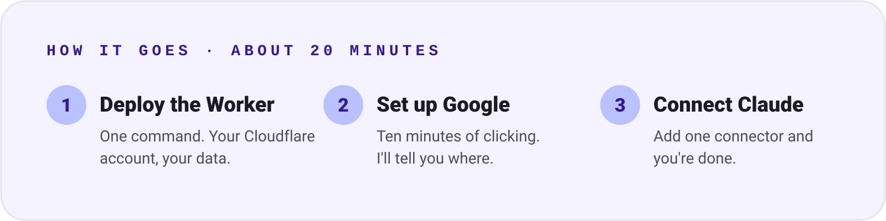

<p align="center">
  
</p>

# Setting it up

Let's get your second inbox into Claude. Budget about 20 minutes. Most of it is Google Cloud, which has a handful of screens that won't let you move on until they're filled in exactly right. I walked into every one of those walls so you don't have to. Each one is marked **Trap** below.

Wherever you see `<worker-host>`, that's your Worker's address, something like `gmail-mcp.your-subdomain.workers.dev`. `<your-subdomain>.workers.dev` is everything after `gmail-mcp.`.

## What you need

- A Cloudflare account. Free works; see "Stuff you should know" in the README for the one catch.
- [bun](https://bun.sh) and git.
- The Google account you want to connect.

## 1. Deploy the Worker first

Do this first, because Google is going to ask for the Worker's address a few times.

```sh
git clone https://github.com/KyleConway/gmail-mcp && cd gmail-mcp
bun install
./node_modules/.bin/wrangler login
bun run deploy
```

It prints your address, `https://<worker-host>`. The first deploy also creates the storage that keeps track of sign-ins. Until you set the secrets in step 8, the Worker turns away every sign-in, so it's perfectly safe to leave running while you click through Google.

Open `https://<worker-host>/` in a browser. You'll get a short guide page, and you can use that page as your app's home page in step 4.

## 2. Make a Google Cloud project and turn on Gmail

1. Head to [console.cloud.google.com](https://console.cloud.google.com/) and make a new project from the picker at the top. Call it whatever you like; `gmail-mcp` works.
2. Go to **APIs & Services → Library**, search for **Gmail API**, and hit **Enable**.

Rather type than click?

```sh
gcloud projects create "gmail-mcp-$(openssl rand -hex 3)" --set-as-default
gcloud services enable gmail.googleapis.com
```

## 3. Run the "Get started" wizard

Go to **[Google Auth Platform → Overview](https://console.cloud.google.com/auth/overview)** and hit **Get started**.

1. **App information:** a name, like `Gmail MCP (personal)`, and your email as the support email.
2. **Audience:** pick **External**.
   - **Trap:** **Internal** only shows up for Google Workspace organizations, and it only lets that organization's accounts in. A regular @gmail.com account needs External. If you're signed in with a work account, double-check this one.
3. **Contact information:** your email.
4. Agree to the policy and hit **Create**.

## 4. Finish the Branding page

Go to **[Branding](https://console.cloud.google.com/auth/branding)**. This is the page that got me. Google won't let you publish until every field here is filled in, and it doesn't make that obvious.

| Field | What to put |
| :-- | :-- |
| App name | Already there from the wizard |
| User support email | Already there |
| App logo | **Leave it empty.** Upload a logo and Google wants to verify your brand before you can publish. Not worth it. |
| Application home page | `https://<worker-host>/` works, or any page you control |
| Application privacy policy link | Any page you control. There's a template below |
| Application terms of service link | Any page you control |
| Authorized domains | Every domain used in the three links above. For the Worker's own pages, that's `<your-subdomain>.workers.dev` |
| Developer contact information | Your email |

**Trap:** every link has to sit on a domain listed under **Authorized domains**, or the page won't save. `workers.dev` on its own is off-limits because it's shared by everybody, but your own slice of it, like `your-subdomain.workers.dev`, is accepted.

Hit **Save**.

### The privacy policy and terms thing

Yes, Google wants a privacy policy for an app with exactly one user. No, it doesn't actually read it. It only checks that the links work and sit on one of your authorized domains. Point them at any page you control, like a GitHub Pages site, a gist, or your own website. Keep it short and honest. This covers both:

```text
Gmail MCP (personal deployment)

This is a private tool operated by <your name> for <your name>'s own Gmail
account. It is not offered to anyone else.

What it accesses: when the operator signs in, Google grants it access to that
one Gmail account (the gmail.modify scope) and to the account's email address.

What it stores: an encrypted Google refresh token, held in the operator's own
Cloudflare account. Mail is read and sent on request and is not stored.

Sharing: no data is sold or shared with anyone. Requests go only to Google's
APIs and to the Claude client the operator connected.

Revoking: remove the app at https://myaccount.google.com/connections.

Terms: provided as is, with no warranty, for the operator's personal use only.

Contact: <your email>
```

## 5. Publish the app

Go to **[Audience](https://console.cloud.google.com/auth/audience)**. Under **Publishing status**, hit **Publish app** and confirm.

- **Trap:** skip this and leave the app in **Testing**, and Google kills its tokens every 7 days. Your connector will mysteriously die every week.
- **Trap:** if **Publish app** is missing or complains, the Branding page isn't finished. Go back to step 4.
- You don't need to add scopes under **Data Access**, and you don't need to submit for verification. A published, unverified app works fine for up to 100 accounts. You'll click past one warning in step 9.

## 6. Create the OAuth client

Go to **[Clients](https://console.cloud.google.com/auth/clients)** and hit **Create client**.

1. **Application type:** **Web application**.
   - **Trap:** Desktop, iOS and friends won't work. The Worker is a web server with a secret.
2. **Name:** anything, like `gmail-mcp worker`.
3. **Authorized JavaScript origins:** leave it empty.
4. **Authorized redirect URIs:** add exactly `https://<worker-host>/callback`.
   - **Trap:** no trailing slash, `https` not `http`, and the *Worker's* address, not claude.ai's.
5. Hit **Create**.

## 7. Download the JSON. Right now.

The next dialog shows your client ID and client secret. Hit **Download JSON** before you close it.

**Trap:** Google shows the secret exactly once. Close the dialog without saving it and you'll have to add a new secret (or make a new client).

Keep the file somewhere private, and delete it once the secrets are set.

## 8. Give the Worker its secrets

Run these from the repo. Each one asks you for the value.

```sh
./node_modules/.bin/wrangler secret put GOOGLE_CLIENT_ID
./node_modules/.bin/wrangler secret put GOOGLE_CLIENT_SECRET
openssl rand -hex 32 | ./node_modules/.bin/wrangler secret put COOKIE_ENCRYPTION_KEY
./node_modules/.bin/wrangler secret put ALLOWED_EMAILS
```

- `GOOGLE_CLIENT_ID` and `GOOGLE_CLIENT_SECRET` come from that JSON file (`client_id` and `client_secret`). Paste the secret into the prompt yourself. Not into a chat with Claude, or with any other assistant.
- `COOKIE_ENCRYPTION_KEY` gets generated and piped straight in, so you never even see it.
- `ALLOWED_EMAILS` is the Google address you're connecting, like `you@gmail.com`. Nobody else gets in.

Check your work with `./node_modules/.bin/wrangler secret list`. Secrets take effect immediately; no redeploy needed.

## 9. Add the connector in Claude

1. In claude.ai, go to **Settings → Connectors** and hit **Add custom connector**.
2. **Name:** `Gmail – Personal`, or whatever helps you tell it apart from the built-in one.
3. **URL:** `https://<worker-host>/mcp/personal`. The last bit is just a label, so a third mailbox could be `/mcp/family`.
4. Leave **Advanced settings** (OAuth client ID and secret) empty. Claude introduces itself to the Worker on its own.
5. Hit **Add**, then **Connect**.
6. The Worker shows an approval dialog naming the client (Claude). Hit **Approve**.
7. Pick your Google account.
8. Google says **Google hasn't verified this app**. Of course it hasn't; it's yours. Hit **Advanced**, then **Go to <your app name> (unsafe)**.
9. On the permissions screen, leave every box ticked, Gmail included, and hit **Continue**.
10. You land back in Claude, connected.

That first sign-in locks your Google account to this connection. Any other client that tries to sign in as you later gets a polite 403.

Connectors you add in claude.ai show up in Claude Code, the desktop app and your phone too, as long as you're signed in to the same Claude account. No `claude mcp add` needed; in fact, it's refused on purpose.

## 10. Decide what Claude can do without asking

In **Settings → Connectors**, open the connector and set each tool to **Always allow**, **Needs approval** or **Blocked**. The README has my recommended table. The gist: reading and drafting are free; sending, trashing and relabeling ask first; and if you never forward mail with Claude, block `forward_message`.

## 11. Make sure it works

Start a new chat and ask:

> Use the Gmail – Personal connector's whoami tool.

Claude should come back with your address. Then try a real search, like "find my most recent email from Google in Gmail – Personal".

If your built-in Gmail connector is on another account, add the routing rule from the README to your Claude preferences, so Claude knows which inbox is which.

## When things go sideways

| What you see | What's going on |
| :-- | :-- |
| `Error 400: redirect_uri_mismatch` from Google | The redirect URI on your OAuth client doesn't exactly match `https://<worker-host>/callback`. Fix it in step 6. |
| `Access blocked: … has not completed the Google verification process` | The app is still in Testing. Publish it (step 5). |
| The connector dies after 7 days | Same thing: still in Testing. Publish it, then reconnect. |
| "This Google account is not allowed on this server" | That account isn't in `ALLOWED_EMAILS`, or Google says its address isn't verified. |
| 403 "pinned to the first OAuth client" | You removed and re-added the connector, so Claude showed up as a new client. Reset the lock with the `wrangler kv key delete` command on that page, or set `ALLOWED_CLIENT_IDS` to the id it shows. Only do this if *you* started the sign-in from Claude's Connect button. |
| "This server only signs in Claude." | The sign-in didn't come from claude.ai. Other clients and localhost callbacks are refused unless you set `ALLOWED_REDIRECT_URIS`. |
| "The Gmail permission was left unticked" | Hit **Choose permissions again** and leave every box ticked. |
| "Google sent no refresh token" | Remove the app at [myaccount.google.com/connections](https://myaccount.google.com/connections) and connect again. |
| "Too many sign-in attempts" | The rate limiter stepped in. Grab a coffee, wait a minute, try again. |

## Staying up to date

```sh
git pull
bun install
bun run deploy
```

Your secrets, storage and sign-ins all survive a redeploy.

Stuck on a step this guide doesn't cover? [Open an issue](https://github.com/KyleConway/gmail-mcp/issues) and I'll take a look.
